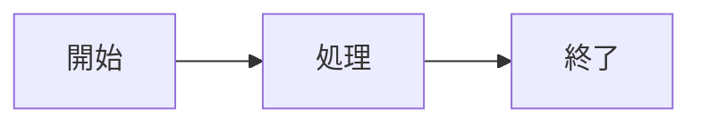

# Markdown to PDF

MarkdownとPDF用プレビューを双方向に同期しながら編集し、PDFとして出力するWebツールです。
サーバー不要の静的ページ（index.html 1枚）なので、GitHub Pagesでそのまま公開できます。
入力した内容は外部サーバーへ送信されず、すべてブラウザ内で処理されます（Google Drive 連携を使う場合は、接続した本人の Google Drive との間でのみ読み書きします）。

> 拡張版（第3版・2026年10月15日）: Google Drive のチームフォルダを正本にするポータル、Update／Rollback／履歴、表のPNG保存、画像の差し替え、日付付きの書き出しを追加しました。
> 第4版: 画面（文書の見た目）だけで編集し、保存のときに Markdown に変換する方式に変更しました（書式ツールバー・表の行列操作・数式／図のクリック編集。Markdown 欄は上級者向けに切り替えで表示）。
> 第5版: 名簿で接続できる人を制限し、役割（マスター／ユーザー／クライアント）ごとに操作を分けました。クライアントは赤字の追記・赤の取り消し線で提案し、マスターが採用／却下します。マスターの「設定」でユーザーとドライブ（フォルダの URL で追加、クライアントはドライブ単位で担当を指定）を管理します。保存は `タイトル_yyyymmdd.md` で、一覧は最新の日付を参照します。設定の雛形は `md2pdf-config.sample.json`。
> 設定ボタン: 画面右上の「設定」から、Google Drive への接続、ルートフォルダ・ドライブの指定（フォルダの URL を貼る）、取り込み、ユーザーの登録と権限（マスター／ユーザー／クライアント）をまとめて行えます。md2pdf-config.json が無くても表示されます（クライアントID・APIキーは設定の「接続の設定」で入れます）。最初にマスターを登録して保存すると、以降は名簿に無いアカウントは接続できません。
> 機能・管理者の設定手順（Google Cloud・`md2pdf-config.json`）・メンバーの使い方は [変更点と使い方.md](変更点と使い方.md) を参照してください。

## 機能

- 双方向同期：左のMarkdownを編集するとプレビューに、右のプレビューを直接編集するとMarkdownに反映
- PDF出力（印刷）：ブラウザの印刷機能で「PDFに保存」。文字が選択・検索できるPDFになり、日本語の文字化けが起きにくい（推奨）
- PDFダウンロード：ボタン1つで直接ダウンロード。ただし画像ベースのPDFになるため文字の選択はできない
- 用紙サイズ（A4 / A5 / Letter）と余白（10〜25mm）の切り替え
- .mdファイルを開く（ボタンまたはドラッグ＆ドロップ）／.md保存（Ctrl+S）
- 内容はブラウザに自動保存（同じブラウザで再度開くと復元）
- GFM対応（表・チェックリスト・取り消し線など）

## 書き方

### 数式（KaTeX）

文中は `$E = mc^2$`、独立した数式は次のように書きます。

```
$$
\int_0^1 x^2 \, dx = \frac{1}{3}
$$
```

`$` を記号として書きたい場合は `\$` と書きます。

### 図（Mermaid）

````

````

フローチャート・シーケンス図・ガントチャートなど、Mermaidの記法がそのまま使えます。
構文に誤りがあると、図の位置に赤字でエラーが表示されます。

### コードの色分け

コードブロックに言語名を付けると色分けされます（例：```` ```js ````、```` ```python ````、```` ```html ````）。

### 注意書きボックス

```
> [!NOTE]
> 補足情報

> [!WARNING]
> 警告
```

種類は NOTE（注記）/ TIP（ヒント）/ IMPORTANT（重要）/ WARNING（警告）/ CAUTION（注意）の5つです。

### 目次

単独の行に `[TOC]` と書くと、見出しから目次を自動生成します。
見出し1（`#`）が1つだけの場合は文書タイトルとみなし、見出し2・3で目次を作ります。

### 改ページ

```
<div class="page-break"></div>
```

## プレビューで編集できるもの・できないもの

- 編集できる：文章、見出し、箇条書き、表、コード、注意書きボックスの本文
- 編集できない（Markdown側で編集）：数式、Mermaid図、目次
  - 変換時に記述が崩れないよう、これらはプレビュー上では1つの部品として扱い、元のMarkdownをそのまま保持します。

## GitHub Pagesでの公開手順

1. GitHubで新しいリポジトリを作成する（例：`md2pdf`）
2. `index.html` と `README.md` をリポジトリ直下にアップロード（Add file > Upload files）してコミットする
3. リポジトリの Settings > Pages を開く
4. Build and deployment の Source を「Deploy from a branch」、Branch を `main` / `/(root)` にして Save
5. 1〜2分後、`https://<ユーザー名>.github.io/<リポジトリ名>/` で公開される

ローカルで試す場合は `index.html` をブラウザで開くだけで動作します（ライブラリ読み込みのためネット接続が必要）。

## 注意点

- 生成済みのPDFファイル自体は編集できません。「PDFの見た目のプレビュー」を編集する仕組みです。
- プレビュー側を編集すると、Markdownは自動整形されます（例：箇条書きの記号が `-` に統一される）。内容は変わりません。
- 印刷でPDF化する際は、印刷ダイアログで「ヘッダーとフッター」をオフにすると余計な日付・URLが入りません。また「背景のグラフィック」をオンにすると、注意書きボックスや表見出しの背景色が出力されます。
- Mermaid図は、文書に図があるときだけライブラリを読み込みます（初回表示に少し時間がかかります）。

## 利用ライブラリ（すべてCDNから読み込み）

- marked：Markdown → HTML
- Turndown + GFMプラグイン：HTML → Markdown
- DOMPurify：HTMLの無害化
- KaTeX：数式
- highlight.js：コードの色分け
- Mermaid：図（必要時のみ読み込み）
- html2pdf.js：直接ダウンロード時のみ読み込み
- html2canvas：表のPNG保存時のみ読み込み
- Google Identity Services／Google Picker：Google Drive に接続したときのみ読み込み

- 記事ごとのサブフォルダ（1階層）の .md も一覧に出します（images・99.・_ で始まるフォルダは除外）。日付は _yyyymmdd / _yyyymmddHHMMSS に対応。

## 版と戻し方（ロールバック）

| 版 | 内容 | 目印（GitHub のブランチ） |
| --- | --- | --- |
| 第6版 v6.4（2026-10-27） | 記事のフォルダを1行の表に（顧客名・フォルダ・ハッシュタグ・note ID・note Secret・更新・削除）。ハッシュタグは note 投稿の既定 | release/v6.4 |
| 第6版 v6.3（2026-10-18） | 設定の「記事のフォルダ」から note アカウントを追加・外す・フォルダごとに指定 | release/v6.3 |
| 第6版 v6.2（2026-10-18） | note 投稿をドライブの予約キュー（md2pdf-note.json）に変更。スプレッドシートと連動しない | release/v6.2 |
| 第6版 v6.1（2026-10-18） | note 投稿（マスターのみ。自動投稿ツールの予約表に記事を登録） | release/v6.1 |
| 第6版 v6.0（2026-10-18 運用版） | 記事フォルダ・設定の簡素化・保存は1ファイル上書き・戻る/進む・ステータス・クライアント制限・ユーザー追加の修正 | release/v6.0 |
| 第5版 v5 | 役割・名簿・提案モード | release/v5 |
| 第4版 v4 | 画面で編集 | release/v4 |
| 第3版 v3 | Google Drive ポータル | release/v3 |

- 第6版以降はサイトの中にも控えがあります: https://unicov-jp.github.io/md2pdf/versions/v6.4/ 、 https://unicov-jp.github.io/md2pdf/versions/v6.3/ 、 https://unicov-jp.github.io/md2pdf/versions/v6.2/ 、 https://unicov-jp.github.io/md2pdf/versions/v6.1/ 、 https://unicov-jp.github.io/md2pdf/versions/v6.0/ （そのまま開いて使えます）
- 公開版をある版に戻すには、その版の `index.html` と `md2pdf-config.json` を最上位に上書きして main に反映します。
  例: `git checkout release/v6.0 -- index.html md2pdf-config.json && git commit -m "v6.0 に戻す" && git push origin main`
- 新しい版を出すときは、`versions/vX.Y/` に控えを作り、`release/vX.Y` のブランチを作ってこの表に1行足します。

## note 投稿（第6版 v6.4・マスターのみ）

- 記事を開いて「note投稿」を押すと、名簿と同じフォルダ（Markdown to PDF）の `md2pdf-note.json`（予約キュー）に、その記事の行を登録・更新します。投稿そのものは note 自動投稿ツール（GitHub Actions、30分ごと）がキューを読んで行い、結果（Result・note URL・Message）をキューに書き戻します。結果はもう一度「note投稿」を開くと見られます。
- スプレッドシートは使いません。キューが無ければ最初の登録で作ります。行の削除・並べ替えはしません。
- 本文（Body）にはこの記事の Drive の URL が入ります。記事をサービスアカウント（noteServiceAccount）に閲覧者、キューを編集者として共有します（通知メールなし）。
- 共通設定（md2pdf-config.json）: `noteQueue: true`（ボタンを出す）、`noteServiceAccount`、`noteAccounts`（キューを新しく作るときの最初の note ID）。
- 「設定」→「記事のフォルダ」は1フォルダ1行の表です: 顧客名／フォルダ／ハッシュタグ／note ID／note Secret／更新／削除。下の「フォルダを追加」の行で同じ項目をまとめて登録できます（顧客名が空なら親フォルダ名）。
- ハッシュタグと note ID は、そのフォルダの記事を「note投稿」で開いたときの既定です（その記事の予約がすでにあれば、予約の内容が優先）。投稿画面で変えたタグはその記事だけに使われ、既定は設定の表でいつでも変えられます。名簿 md2pdf-team.json に保存します。
- note ID を入れると、予約キューの「アカウント」に追加されます。どのフォルダにも使われなくなった note ID は、その行を空にします（行番号は保ちます）。note Secret の名前（`NOTE_COOKIE_<ID>`）で、GitHub の Secrets に Cookie を登録します。
- 投稿方法: 予約投稿（日時指定）／通常投稿（次の確認で公開）／下書き保存／投稿済みの記事を上書き。下書き保存以外は記事のステータスを「投稿待ち」にします。
